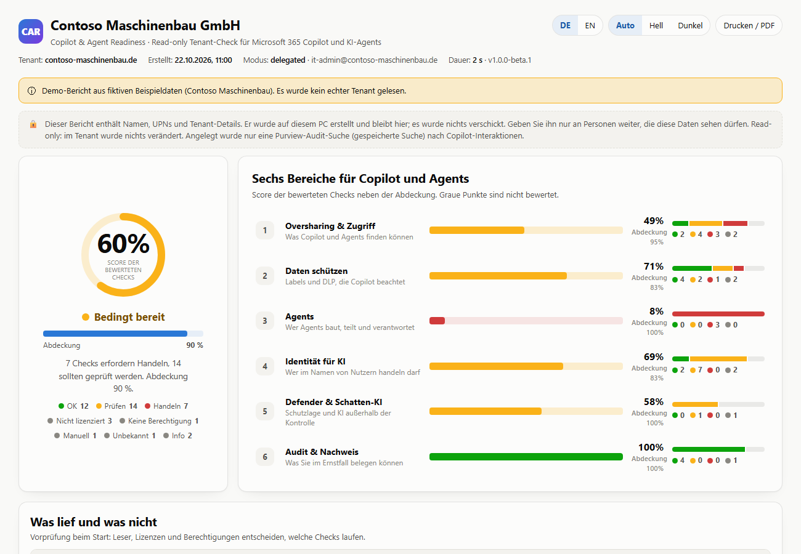
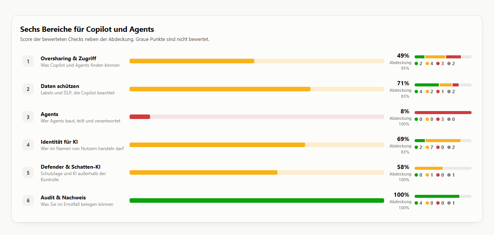
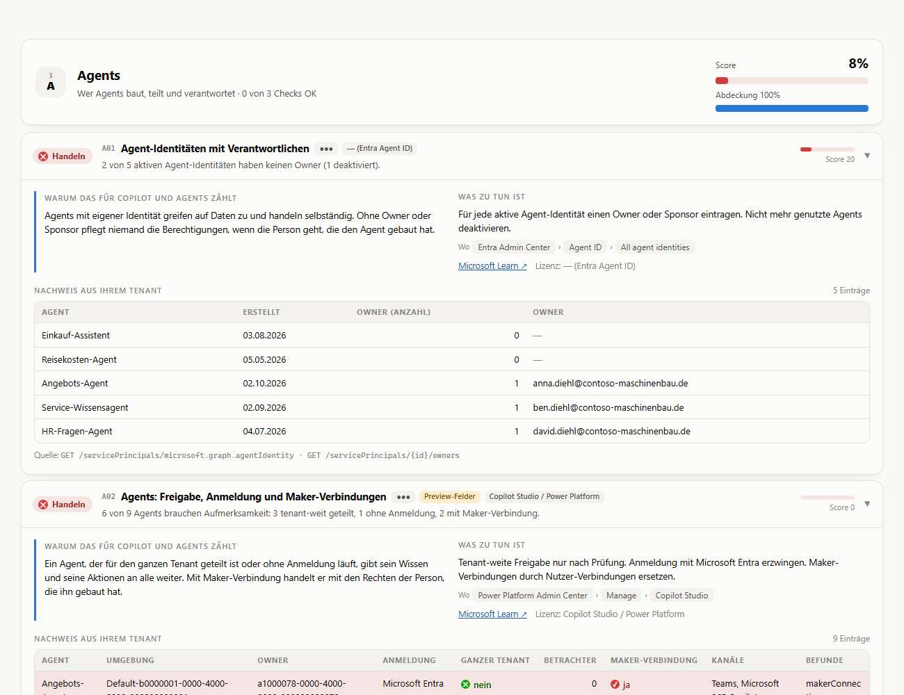
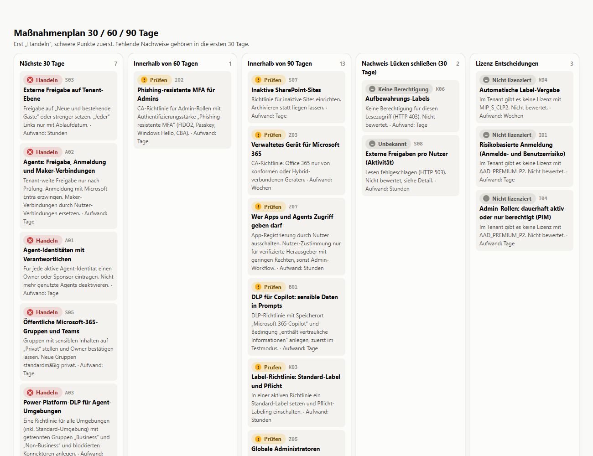
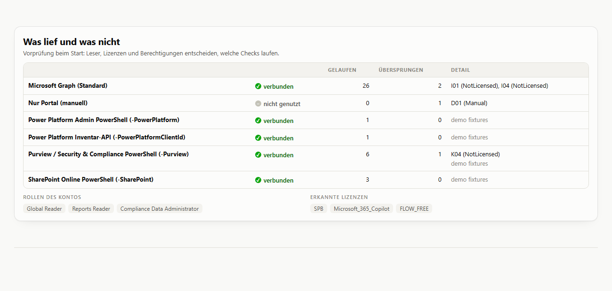

<div align="center">

# 🛡️ Copilot & Agent Readiness for Microsoft 365

### Is your Microsoft 365 ready for Microsoft 365 Copilot and AI agents?

**One command. One sign-in. One report.**
Free, open source and **read-only**.

**[govnex.de](https://govnex.de)** · by [Rashad Bakirov](https://www.linkedin.com/in/rashadbakirov)

[🇩🇪 Deutsch](README.md) · 🇬🇧 English

[](#-why-you-can-trust-this-tool)
[](#-why-you-can-trust-this-tool)
[](#-why-you-can-trust-this-tool)
[](#-get-started)
[](LICENSE)

</div>

---

Microsoft 365 Copilot and AI agents see everything the signed-in user may see — and in most tenants that
is considerably more than anyone expects. This tool checks **41 points** in your tenant and tells you, in
one report, what to fix **before** the rollout: oversharing, labels, DLP for Copilot, who owns the agents,
identity, and whether you could prove any of it afterwards.

<div align="center">

### 👉 [Open an example report in your browser](https://www.govnex.de/copilot-check/beispiel.html)

*A complete report before you run anything — on govnex.de, no download.*

</div>



> 📄 The same report is in this repository:
> [`docs/example-report-en.html`](docs/example-report-en.html) · [Deutsch](docs/beispielbericht-de.html)
> *("Contoso Maschinenbau GmbH" — an invented company. No real tenant, no real data.)*

---

## 🚀 Get started

You need **PowerShell 7.2 or later** and an account with read rights in your tenant. No module, no app
registration, no client secret. Only the very first run in a tenant needs a **Global Administrator** once, to
consent to the read permissions (see [roles](#-permissions-in-detail)).

```powershell
git clone https://github.com/rashadbakirov/m365-copilot-readiness.git
cd m365-copilot-readiness

./Invoke-CopilotReadiness.ps1 -TenantId your-domain.com -Language en
```

Without git: on GitHub choose **Code → Download ZIP**, extract it, and run `Get-ChildItem -Recurse | Unblock-File`
once in the extracted folder — otherwise Windows marks the downloaded scripts as coming from the internet.

That is it. What happens then:

| | Step | |
|:--:|---|---|
| 1️⃣ | **Disclosure page** | The tool first tells you what it does, what it reads and what it never does — and waits for your Enter. |
| 2️⃣ | **One sign-in** | One browser window, you pick your account. Nothing to type. |
| 3️⃣ | **Tenant confirmation** | Name, domain, tenant id and account are shown before the first check runs. Without `-TenantId` the tool waits for your Enter here; with `-TenantId` it stops if the sign-in belongs to another tenant. |
| 4️⃣ | **Report** | An HTML file in `out\` that opens by itself. Works offline, prints cleanly, switches between German and English. |

**One sign-in** covers the 28 Graph checks. Every later run against the same tenant needs no window at all —
whether you name the tenant by domain or by id.

<details>
<summary><b>Up to 40 checks instead of 28 (optional)</b></summary>

<br>

Three areas sit behind Microsoft modules you install yourself. Without them those checks stay *Manual* and
only lower the coverage — the run never fails:

```powershell
Install-Module ExchangeOnlineManagement -Scope CurrentUser                       # Purview
Install-Module Microsoft.Online.SharePoint.PowerShell -Scope CurrentUser         # SharePoint
Install-Module Microsoft.PowerApps.Administration.PowerShell -Scope CurrentUser  # Power Platform

./Invoke-CopilotReadiness.ps1 -Deep -Purview -SharePoint -Language en
./Invoke-CopilotReadiness.ps1 -Deep -PowerPlatform -Language en
```

⚠️ **`-Purview` and `-PowerPlatform` cannot run together.** The two modules ship different versions of
`Microsoft.Identity.Client`; only the one that authenticates first works. Pass both and Purview keeps the
session — the tool says so.

</details>

---

## 🔒 Why you can trust this tool

You are giving a stranger's script access to your tenant. That worry is reasonable — which is why **every**
run opens with this page, before a single call is made:

```text
  Before you sign in — what this tool does and does not do
  ----------------------------------------------------------------------------

  Read-only. It requests read permissions only ('.Read'), and the code can
  call no other kind. Nothing in your tenant is changed, enabled, deleted or
  configured.

  It acts only as you. The sign-in is delegated: the tool sees exactly what
  your own account may see, nothing more. ...

  Permissions that will be requested (11):
    - Organization.Read.All
    - Directory.Read.All
    ...

  Press Enter to sign in, or Ctrl+C to stop.
```

| | |
|---|---|
| 👁️ **Read-only** | Only `.Read` permissions are requested. The optional readers may call nothing but `Get-` cmdlets — that is enforced in code, not promised in a README. |
| 👤 **Only your account** | Delegated sign-in through Microsoft's own *Graph Command Line Tools* app. No app registration, no client secret, no service left running. Without a signed-in human, nothing happens at all. |
| 💻 **Your data stays here** | The report and the JSON are written to `out\` on your PC. Nothing is uploaded, no telemetry is sent, govnex never sees your results. |
| ✍️ **Exactly one object** | The only thing created is one Purview audit search (a saved search) for Copilot interactions of the last 7 days, needed by N01/N02. Nothing else. Purview lists it under Audit → Search and removes it after 30 days by itself; every run creates a new one unless you reuse an existing one with `-AuditQueryId`. |
| 🔑 **Revocable any time** | Entra → Enterprise applications → *Microsoft Graph Command Line Tools* → Permissions. `-Logout` deletes the saved sign-in on your PC. |
| 📖 **Checkable** | MIT licence, full source, and every permission documented below with the check that needs it. |

> **About the consent:** the permissions below require admin consent. When a Global Administrator grants
> them, the consent applies **tenant-wide and stays until it is revoked** — that is how Entra works, not
> something specific to this tool. It applies to Microsoft's *Graph Command Line Tools* app, which the
> *Microsoft Graph PowerShell SDK* also uses: revoking it therefore also affects admins who work with that.

---

## 📊 What you see in the report

**Six areas, one score, an honest coverage figure.** Each area answers: *why does this matter for Copilot
and agents?*



**Every check shows the evidence from your tenant** — no claim without numbers: what was found, why it
matters for Copilot, what to do, where in the admin center, and the matching Microsoft Learn page. Here the
**Agents** area: who built the agents, who owns them, and who looks after them when that person leaves.



**And it ends with a plan, not a pile of problems** — sorted by effort and weight into 30 / 60 / 90 days,
plus the evidence gaps to close first and the items that are purely licence decisions.



**The tool also tells you what it did *not* know.** Every run starts with a preflight: which readers were
connected, which licences are missing, which checks could therefore not run. A check without data never
turns green.



---

## 🧮 Result states and score

Only **OK / Review / Act** are scored. Everything else is grey and never counts as a pass.

| State | Meaning | Scored | In coverage |
|---|---|---|---|
| 🟢 **OK** / 🟡 **Review** / 🔴 **Act** | assessed | yes | yes |
| ⚪ Not licensed | the tenant lacks the licence | no | yes (lowers coverage) |
| ⚪ No permission | the account was not allowed to read (401/403) | no | yes |
| ⚪ Manual | needs an optional reader or a portal check | no | yes |
| ⚪ Unknown | the read failed or the data was incomplete | no | yes |
| ⚪ Not applicable | does not apply (e.g. no guests) | no | no |
| ⚪ Info | context only (e.g. Copilot usage) | no | no |

**Score** = weighted average (weight 1 to 3) of the assessed checks. A single check's score stays inside the
band of its state (OK ≥ 75, Review 45–74, Act < 45), so colour and number never contradict each other.
**Coverage** = assessed weight ÷ weight of all applicable checks.
There is an overall verdict only from **70 % coverage** and at least 25 % per area — otherwise the report
says **Incomplete**. The thresholds live in `src/Manifest.json`.

---

## ✅ What it checks

<!-- checks:start -->
| ID | Area | Check | Reader | Scored | Weight |
|---|---|---|---|---|---|
| S01 | Oversharing & access | Copilot licences and assignment | Graph | yes | 2 |
| S02 | Oversharing & access | Copilot usage (adoption, not scored) | Graph | info | 1 |
| S03 | Oversharing & access | Tenant-level external sharing | Graph | yes | 3 |
| S04 | Oversharing & access | Sharing hygiene | Graph | yes | 1 |
| S05 | Oversharing & access | Public Microsoft 365 groups and Teams | Graph | yes | 3 |
| S06 | Oversharing & access | Groups without an owner | Graph | yes | 2 |
| S07 | Oversharing & access | Inactive SharePoint sites | Graph | yes | 2 |
| S08 | Oversharing & access | External sharing per user (activity) | Graph | yes | 1 |
| S09 | Oversharing & access | Inactive guests | Graph | yes | 2 |
| S11 | Oversharing & access | Restricted Content Discovery and Restricted Access Control per site | `-SharePoint` | yes | 2 |
| S12 | Oversharing & access | Oversharing reports (data access governance): present and current | `-SharePoint` | yes | 2 |
| K01 | Protect data | Sensitivity labels in the tenant | Graph | yes | 3 |
| K02 | Protect data | Labels for Teams, groups and sites | Graph | yes | 2 |
| K03 | Protect data | Label policy: default label and mandatory labelling | `-Purview` | yes | 2 |
| K04 | Protect data | Automatic labelling | `-Purview` | yes | 2 |
| K05 | Protect data | Labels on real content (DAG label report) | `-SharePoint` | yes | 2 |
| K06 | Protect data | Retention labels | Graph | yes | 1 |
| B01 | Protect data | DLP for Copilot: sensitive data in prompts *(preview fields)* | `-Purview` | yes | 2 |
| B05 | Protect data | DLP for Copilot: labelled files and emails | `-Purview` | yes | 2 |
| B02 | Protect data | DLP coverage of exits | `-Purview` | yes | 2 |
| A01 | Agents | Agent identities with accountable owners | Graph | yes | 3 |
| A02 | Agents | Agents: sharing, sign-in and maker connections *(preview fields)* | `-PowerPlatform -PowerPlatformClientId` | yes | 3 |
| A03 | Agents | Power Platform DLP for agent environments | `-PowerPlatform` | yes | 2 |
| Z01 | Identity for AI | MFA for all users via Conditional Access | Graph | yes | 3 |
| Z02 | Identity for AI | Legacy authentication blocked | Graph | yes | 2 |
| Z03 | Identity for AI | Managed device for Microsoft 365 | Graph | yes | 2 |
| Z04 | Identity for AI | MFA registration | Graph | yes | 2 |
| Z05 | Identity for AI | Global Administrators | Graph | yes | 2 |
| Z06 | Identity for AI | Guest invitations and guest role | Graph | yes | 1 |
| Z07 | Identity for AI | Who may grant apps and agents access | Graph | yes | 2 |
| I01 | Identity for AI | Risk-based sign-in (sign-in and user risk) | Graph | yes | 2 |
| I02 | Identity for AI | Phishing-resistant MFA for admins | Graph | yes | 3 |
| I03 | Identity for AI | Apps and agents with far-reaching permissions | Graph | yes | 2 |
| I04 | Identity for AI | Admin roles: permanently active or eligible only (PIM) | Graph | yes | 2 |
| S10 | Defender & shadow AI | Secure Score: open data and identity actions | Graph | yes | 1 |
| D01 | Defender & shadow AI | Shadow AI: AI services in use (check in the portal) | portal (manual) | info | 1 |
| N01 | Audit & evidence | Audit log searchable | Graph | yes | 3 |
| N02 | Audit & evidence | Copilot interactions in the audit log | Graph | yes | 2 |
| N03 | Audit & evidence | Entra log retention (info) | Graph | info | 1 |
| B03 | Audit & evidence | Retention for Copilot interactions | `-Purview` | yes | 2 |
| N04 | Audit & evidence | Alerts for DLP and data | `-Purview` | yes | 1 |
<!-- checks:end -->

No longer included: B04 Restricted SharePoint Search (Microsoft is retiring it, replaced by S11) and
B06 Copilot admin settings (no documented read API).

---

## 🔑 Permissions in detail

Every permission is a **read** permission. By default only the 11 of the core set are requested; `-Deep`
additionally asks for the three newer ones, of which only **A01** strictly needs one.

<!-- scopes:start -->
| Permission | Set | Used by |
|---|---|---|
| `Organization.Read.All` | core | S01, N03 |
| `Directory.Read.All` | core | S01, S05, S06, S09, Z05, I03 |
| `Policy.Read.All` | core | Z01, Z02, Z03, Z06, Z07, I01, I02 |
| `Reports.Read.All` | core | S02, S07, S08 |
| `AuditLog.Read.All` | core | S09, Z04 |
| `SecurityEvents.Read.All` | core | S10 |
| `SharePointTenantSettings.Read.All` | core | S03, S04 |
| `RoleManagement.Read.Directory` | core | Z05, I04 |
| `AuditLogsQuery.Read.All` | core | N01, N02 |
| `InformationProtectionPolicy.Read` | core | K01, K02 |
| `RecordsManagement.Read.All` | core | K06 |
| `SensitivityLabel.Read` | extended | K01, K02 |
| `ReportSettings.Read.All` | extended | S07 |
| `AgentIdentity.Read.All` | extended | A01 |
<!-- scopes:end -->

**Roles:** the first sign-in needs a **Global Administrator** (or Privileged Role Administrator) once, for
the consent. After that **Global Reader** is enough. Individual reads need more: usage reports **Reports
Reader**, agent identities **Agent ID Administrator**, Purview cmdlets a Purview read role, SharePoint
cmdlets **SharePoint Administrator**, Power Platform **Power Platform Administrator**.

**Agent inventory (A02).** The Power Platform inventory API only accepts delegated tokens from an app
registration in your own tenant. This tool never creates one. If you want A02, create it yourself once: a
public-client app, delegated permission `ResourceQuery.Resources.Read`
(API id `8578e004-a5c6-46e7-913e-12f58912df43`), admin consent — then `-PowerPlatformClientId <app id>`.
Without it A02 stays *Manual*.
[Power Platform API authentication](https://learn.microsoft.com/power-platform/admin/programmability-authentication-v2)

---

## ⚙️ All parameters

| Parameter | Purpose |
|---|---|
| `-TenantId <domain or id>` | pin the tenant (recommended). If the sign-in belongs elsewhere, the run stops and reads nothing. |
| `-Language en` | English report (default `de`; switchable inside the report) |
| `-Deep` | also request the three newer read permissions (only A01 needs one of them) |
| `-Purview` | optional: Security & Compliance PowerShell (label policies, DLP for Copilot, retention, alerts) |
| `-SharePoint [-SharePointAdminUrl <url>]` | optional: SharePoint Online PowerShell (RCD/RAC per site, data access governance reports) |
| `-PowerPlatform [-PowerPlatformClientId <app id>]` | optional: Power Platform admin PowerShell (DLP for agent environments); with an app id also the agent inventory |
| `-Only S01,Z01` | run selected checks only (no overall verdict then) |
| `-AuditQueryId <id>` | reuse an existing audit search |
| `-Yes` | skip the disclosure page and the tenant confirmation (unattended runs). Without `-Yes` the tool stops in a window that cannot take input, instead of skipping the page silently. |
| `-DeviceCode` | sign in with a device code instead of the browser (SSH, remote shell, host without a desktop) |
| `-NoTokenCache` | do not remember the sign-in for the next run |
| `-Logout [-TenantId <domain or id>]` | delete the saved sign-in and exit; with `-TenantId` for that tenant only |
| `-OutputPath <folder>` | write the report and JSON to another folder (default `out\` next to the script) |
| `-NoOpen` | do not open the report automatically |

`Get-Help ./Invoke-CopilotReadiness.ps1 -Full` shows the same parameters with examples.

**Saved sign-in.** Only the refresh token is stored, in `%LOCALAPPDATA%\govnex\cr-token.dat`, encrypted
with DPAPI at *CurrentUser* scope — readable solely by the same Windows user on the same machine. One entry
per tenant and permission set. Note: a refresh token belongs to Microsoft's *Graph Command Line Tools* app and
your account. It can be redeemed for access tokens for **every** permission that app has been granted in your
tenant — not only for this tool's read permissions. Treat the file like a sign-in; `-Logout` deletes it,
`-NoTokenCache` never creates it. On Linux and macOS nothing is stored (DPAPI does not exist there), so every
run signs in again.

---

## 🧭 Limits

- Configuration evidence, **not** a file-level scan and not a simulation of what Copilot would answer.
- Preview fields (agent sharing, sign-in, connectors) can be empty. Empty means **Unknown**, never safe.
- Licence detection uses service plan names; trials or new SKUs may need a manual look.
- Shadow AI discovery (Defender for Cloud Apps) is only a pointer in v1.
- Entra log export to Log Analytics / Sentinel is not read (N03 is info only).

---

<div align="center">

**Want to talk the result through? 30 minutes, free.**

[govnex.de](https://govnex.de)

MIT licence · nothing in your tenant is changed

</div>
